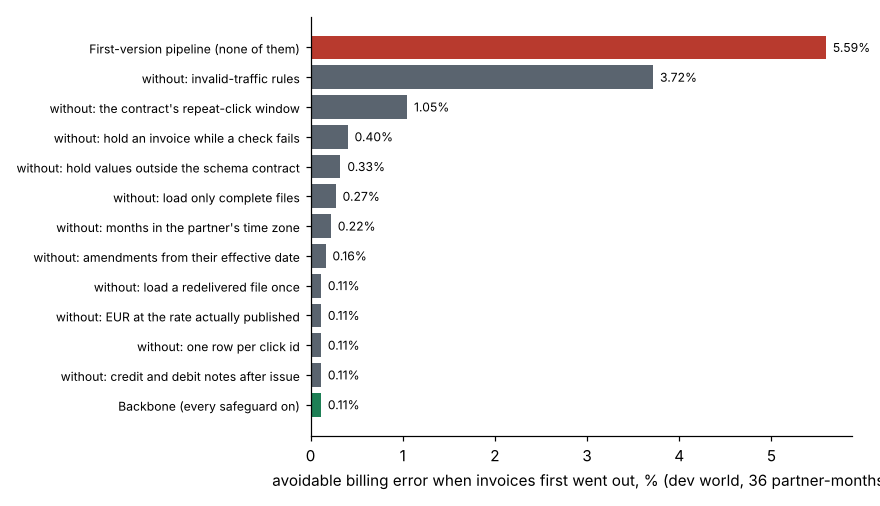
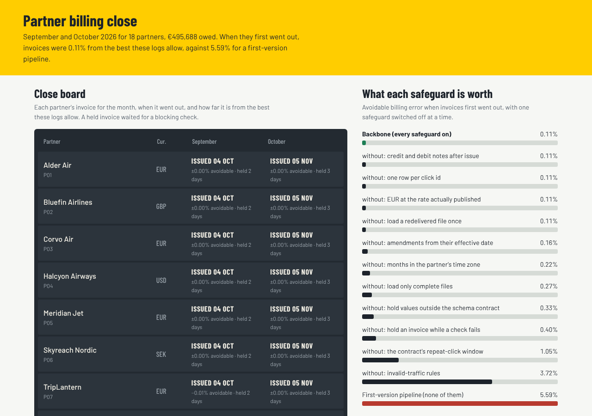

# metasearch-billing-backbone

**Redirect logs in, partner invoices out, and checks that stop a wrong invoice before it goes out.**

A travel metasearch earns most of its money per click: a traveller clicks an airline's or a hotel's offer, the
partner pays the agreed price for that click, and once a month the BI team's pipeline turns the redirect logs
into an invoice for each partner. That pipeline is the company's single source of truth for revenue, and the
place where ordinary data problems turn into money: a log file that arrives an hour late, an app release that
logs every redirect twice, a scraper, a rate change signed after the fact, a month that ends at a different
moment in New York than in Berlin.

This repository is that backbone, built the way it has to run, and measured against a simulated world that
knows what every partner really owed:

- **Ingest:** hourly redirect logs from four brands (KAYAK, momondo, Cheapflights, HotelsCombined), loaded once
  and only when complete (manifest and content hash), into DuckDB; the control store on PostgreSQL.
- **Transform:** eleven SQL models, written once and run on both DuckDB and **Trino** (CI compares every row):
  typing through each brand's schema contract, one row per click id, invalid-traffic rules, the partner's
  repeat-click window, months in the partner's own time zone, a bi-temporal rate card, invoice lines, EUR revenue.
- **Test:** blocking checks per partner and month (missing hours, values outside the contract, unpriced clicks,
  lines that do not add up to the fact) and monitoring checks per brand and day (late files, volume, duplicate
  click ids, invalid traffic, reference rates, the partner's own count). Every result is recorded.
- **Invoice:** an invoice waits while a blocking check fails; after issue a change becomes a credit or debit
  note, never an overwrite. Money is integer minor units.
- **Orchestrate:** the same four steps as an **Airflow** DAG and as **Rundeck** jobs, one CLI underneath;
  Docker image and a compose stack with PostgreSQL and Trino.
- **Self-service:** certified metrics in `config/metrics.toml` and an "ask the billing data" endpoint: a question
  becomes a plan, the catalog checks it and writes the SQL, and a question no metric answers is refused.

Every partner, price and click here is simulated; the partner names are invented.

## Results

<!-- results:start (generated by scripts/readme.py from reports/; do not edit) -->

Two yardsticks. **Avoidable error** is the distance from the best any pipeline could bill from these logs; **against what was truly owed** also counts the bots that are indistinguishable from people in them.

| Dev world, 36 partner-months | Backbone | First-version pipeline |
|---|---:|---:|
| Avoidable billing error when invoices first went out | **0.11%** (€568) | 5.59% (€28,205) |
| Invoices avoidably off by more than 0.5% when first issued | **4 of 36** | 36 of 36 |
| Billing error against what was truly owed, after notes | **1.90%** (€9,429) | 7.46% (€36,962) |
| of which bots indistinguishable from people in the logs | €8,757 | €8,757 |
| Partner disputes (partner's own count more than 2% away) | **13** | 36 |
| Invoices sent while a blocking check was failing | **0** | 18 |
| Credit and debit notes issued | 1 | 0 |
| Latest day of the month an invoice went out | 5 | 2 |
| EUR revenue mart against the truth | **1.90%** | 7.95% |

€495,688 truly owed over September and October; 8,100 check results recorded, 122 alerts raised.



**What each safeguard is worth** (the backbone with one switched off, everything else equal):

| Pipeline | Avoidable error, first issue | Avoidable error, after notes | Invoices avoidably off by more than 0.5% (first issue) | Partner disputes |
|---|---:|---:|---:|---:|
| **Backbone (every safeguard on)** | 0.11% | 0.14% | 4 of 36 | 13 |
| **First-version pipeline (none of them)** | 5.59% | 5.59% | 36 of 36 | 36 |
| without: invalid-traffic rules | 3.72% | 3.75% | 36 of 36 | 36 |
| without: the contract's repeat-click window | 1.05% | 1.08% | 29 of 36 | 31 |
| without: hold an invoice while a check fails | 0.40% | 0.14% | 12 of 36 | 5 |
| without: hold values outside the schema contract | 0.33% | 0.14% | 12 of 36 | 7 |
| without: load only complete files | 0.27% | 0.28% | 4 of 36 | 9 |
| without: months in the partner's time zone | 0.22% | 0.25% | 3 of 36 | 15 |
| without: amendments from their effective date | 0.16% | 0.16% | 4 of 36 | 13 |
| without: credit and debit notes after issue | 0.11% | 0.11% | 4 of 36 | 13 |
| without: one row per click id | 0.11% | 0.14% | 4 of 36 | 13 |
| without: EUR at the rate actually published | 0.11% | 0.14% | 4 of 36 | 13 |
| without: load a redelivered file once | 0.11% | 0.14% | 4 of 36 | 13 |

**Planted incidents** (the pipeline is not told about any of them):

| Planted incident | Where | First check to fail | Hours from start to alert |
|---|---|---|---:|
| Log shipping stopped | cheapflights, 2026-09-30 | `files_complete` | 13.0 |
| Log shipping stopped | momondo, 2026-10-08 | `hourly_files_in` | 20.0 |
| Every redirect logged twice | kayak, 2026-10-06 | `duplicate_click_ids` | 30.0 |
| Scraper clicking hotel offers | hotelscombined, 2026-10-12 | `invalid_traffic_share` | 30.0 |
| New device value before the schema contract | momondo, 2026-10-29 | `values_in_contract_daily` | 30.0 |
| Reference rates stopped arriving | ECB reference rates, 2026-09-23 | `fx_published` | 39.0 |

**Invalid-traffic rules:** 99.98% of flagged clicks were really invalid; they caught 97.6% of the bots that show a signal in the logs and 84.9% of the scraper storm, and flagged 6 real people. 12,451 bot clicks came through residential proxies at human pace; nothing in redirect logs separates them from travellers, so they were billed.

**Held-out world, first and only run** (another seed, other incidents, settings frozen before it ran):

| | Backbone | First-version pipeline |
|---|---:|---:|
| Avoidable billing error when invoices first went out | **0.18%** | 4.78% |
| Invoices avoidably off by more than 0.5% when first issued | **7 of 36** | 36 of 36 |
| Billing error against what was truly owed, after notes | 1.94% | 6.66% |
| Partner disputes | **12** | 36 |
| Incidents caught | **6 of 6** | — |

**Query rewrites** (on 750,226 clicks, x86_64, 3.13.16; identical rows required):

| Query | Before | After | Faster | Same rows |
|---|---:|---:|---:|---|
| price each click by the contract as known now | 0.381 s | 0.284 s | 1.3× | yes |
| find repeat clicks inside the partner's window | 0.557 s | 0.278 s | 2.0× | yes |

<!-- results:end -->

**Reading the safeguard table.** Two safeguards carry most of the weight on this data: the invalid-traffic rules
and the contract's repeat-click window. Holding invoices and holding unknown values matter at first issue and
are repaired by notes afterwards, which is why their "after notes" column falls back to the backbone's. Four rows
show no effect, and that is a finding, not a bug: the repeat-click window also absorbs a redirect logged twice (the
copies arrive seconds apart), the click-id rule absorbs a file delivered twice, and the EUR rate rule only changes
the revenue mart while the rates are late, not after they arrive. Switching notes off looks marginally better
because one missed amendment happened to cancel the scraper's over-billing on the same invoice. Alerts come about
30 hours after an incident starts because the run is daily at 06:00 UTC and judges completed days.



`web/` is the close dashboard (React, TanStack Query, Framer Motion): the close board, what each safeguard is
worth, the planted incidents, and the ask box against the API. It reads `web/public/data/dashboard.json`, written
by `scripts/readme.py` from the reports.

## How it works

```
 brands' hourly redirect logs ─┐   contracts: partners, rate cards,     ECB reference    partners' own
 (late, half-uploaded, twice)  │   schema contracts (late amendments)   rates (late)     click counts
                               ▼                 ▼                          ▼                 ▼
                   ┌────────────────────── landing zone, seen as of each run ──────────────────────┐
                   │ load: manifest + sha256, a path once, a content hash once  → raw_clicks       │
                   │ build: stg → unique → scored → local → billable → priced → fct → marts        │
                   │        (DuckDB here, the same SQL on Trino)                                   │
                   │ check: blocking per partner/month, monitoring per brand/day → check_result     │
                   │ invoice: issue, hold, or add a note        → invoice_register (insert only)    │
                   └───────────────────────────────────────────────────────────────────────────────┘
                     control store (file ledger, runs, checks, alerts, invoices): PostgreSQL or DuckDB
                     scheduled by Airflow or Rundeck: mbb load → mbb build → mbb check → mbb invoice
```

| Planted in the world | What the backbone does |
|---|---|
| A brand's logs stop for hours, then arrive days later | `files_complete` holds that partner-month; the invoice goes out once the hours are in |
| An app release logs every redirect twice | one row per click id; `duplicate_click_ids` alerts the same day |
| A scraper clicks hotel offers from a few networks | invalid-traffic rules; `invalid_traffic_share` alerts |
| A brand sends `MOBILE_APP` before its schema contract lists it | the clicks are held in `stg_quarantine`, the invoices wait, then the clicks come back |
| A rate amendment signed weeks after it applies | the rate card is bi-temporal; recorded after issue, it becomes a debit or credit note |
| The reference-rate file stops arriving | the last published rate is used and flagged; the EUR mart restates when the files arrive |
| Month ends at different moments for each partner | months and rate dates in the partner's time zone, DST included |
| Half-uploaded files, files delivered twice | loaded only when the manifest matches, and a content hash once |

## Run it

```bash
pip install -e ".[dev]"
mbb world --out data/dev                                        # the simulated world (~45 s)
mbb schedule --world data/dev --state data/dev/warehouse.duckdb # every daily run, 2 Sep to 10 Nov
mbb ask "billed clicks by brand last month" --state data/dev/warehouse.duckdb
mbb serve --state data/dev/warehouse.duckdb                     # API on :8000
cd web && npm install && npm run dev                            # the dashboard

python3 scripts/evaluate.py          # backbone, first version and each safeguard off, against the truth
python3 scripts/bench.py             # the two query rewrites, timed
python3 scripts/trino_parity.py      # every model on a running Trino against DuckDB
docker compose -f deploy/docker-compose.yml up --build
```

## Limits

- **The world is simulated and mine.** It holds the problems I thought of; the held-out world, run once, is the
  check against tuning to it. Real redirect logs are larger and messier.
- **Bots that look like people are billed.** Residential proxies at human pace leave nothing in these logs that
  separates them from travellers. Closing that needs signals such as partner conversion feedback.
- **Scale.** Two months, about 700,000 clicks, one machine. The SQL runs on Trino in CI, but only on a small world.
- **The query rewrites matter less on DuckDB than I expected:** 1.3× and 2.0× with identical rows, because DuckDB
  already decorrelates both. They are timed on DuckDB only, not on Trino.
- **The held-out world was harder than the dev world:** 7 of 36 invoices avoidably off by more than 0.5% at first
  issue, against 4 on dev, mostly the scraper's clicks that passed the rules. The numbers stand as they came out.
- **The Claude reader is optional and not measured.** The evaluation measures the rule-based reader; with an
  API key, `mbb ask --claude` uses the same plan, catalog and refusals.

Decisions and their costs: [docs/decisions.md](docs/decisions.md). How to work on it: [AGENTS.md](AGENTS.md).
